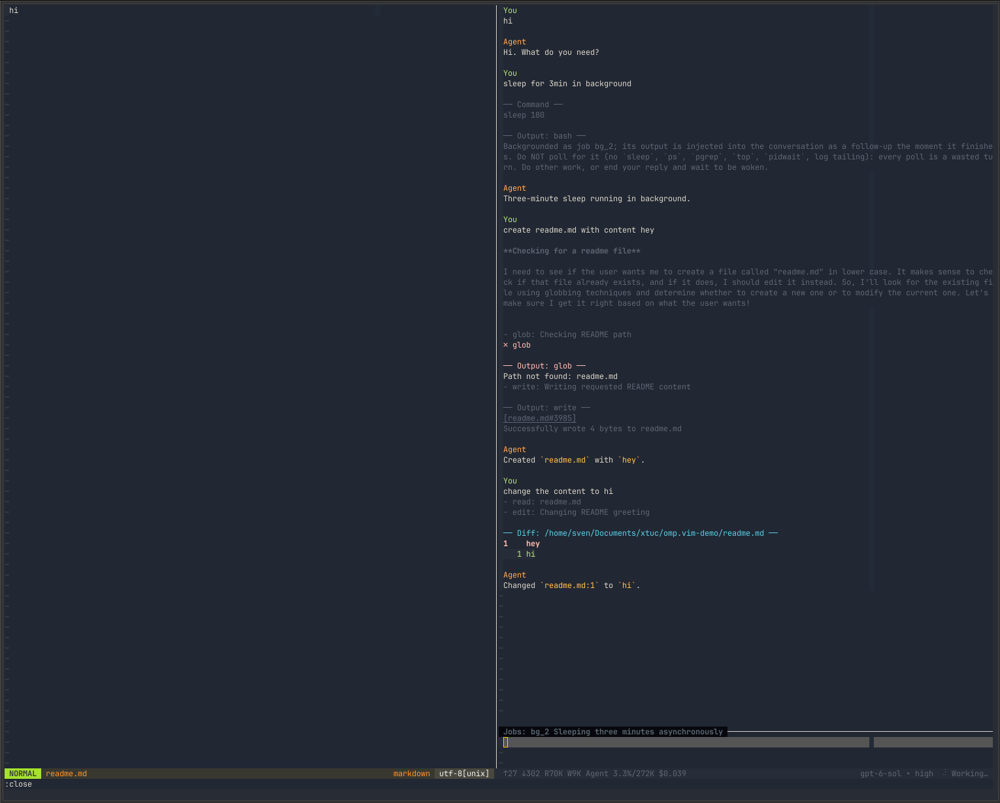

# omp.vim

Advanced oh-my-pi integration for Neovim.

<p align="center">
  
</p>

Put in your `~/.vimrc`:

```vim
Plug 'xtuc/omp.vim'
" ...
nnoremap <silent> <leader>o :lua require('omp').open()<CR>
```

## Key bindings

### Prompt

| Mode | Keys | Action |
| --- | --- | --- |
| Normal | `<Enter>` | Send prompt. From insert mode, press `<Esc>` first. |
| Insert | `<Enter>` | Insert newline; does not send. |
| Normal | `<C-c>` | Abort current response. |
| Normal or insert | `<C-r>` | Open CtrlP prompt history, if CtrlP is installed. `<Enter>` loads chosen prompt without sending; `<Esc>` closes picker and preserves draft. |
| Normal or insert | `<Up>` / `<Down>` | Browse history at first/last line of prompt; otherwise move cursor within multiline prompt. `<Down>` past newest entry restores draft. |
| Normal | `k` / `j` | Same edge-of-prompt history navigation; otherwise move cursor. |

### Transcript

| Mode | Keys | Action |
| --- | --- | --- |
| Normal | `i`, `a`, `o`, etc. | Focus prompt pane and enter insert mode. |
| Normal | `:q` | Close transcript pane. |

### Dialogs

Choices and approvals replace prompt pane temporarily; existing prompt draft returns afterward. This is a read-only selection view, not a text field: `> ` marks selected option. Request details appear below options. Pane keeps its width, grows vertically for details, and wraps long lines; use `j` / `k` or arrows to scroll, then return to an option before pressing `<Enter>`. Input and multiline editor still open popups.

On Linux, approvals and questions show desktop alerts. Alerts stay until answered or dismissed.

| Dialog | Mode | Keys | Action |
| --- | --- | --- | --- |
| Choice or approval | Normal | `<Enter>` | Select option under cursor. On detail text, `<Enter>` does nothing. |
| Tool approval | Normal | `a` / `r` | Approve / Reject immediately; no `<Enter>` needed. Starts on Reject, so `<Enter>` alone also rejects. Eligible approvals save project grant. |
| Confirmation | Normal | `a` / `r` | Confirm / Reject immediately; no `<Enter>` needed. Starts on Reject; `j`, then `<Enter>` also confirms. |
| Choice or approval | Normal | `q` or `<Esc>` | Dismiss choice or reject approval. |
| Input popup | Insert or normal | `<Enter>` | Submit text. |
| Input popup | Insert | `<Esc>` | Cancel input. |
| Input popup | Normal | `q` or `<Esc>` | Cancel input. |
| Multiline editor popup | Insert | `<Enter>` / `<Esc>` | Insert newline / return to normal mode. |
| Multiline editor popup | Normal | `<Enter>` / `q` | Submit text / cancel. |

## Features

- Transcript auto-follows new output while prompt pane is selected; scroll independently when transcript pane is selected. Multiline prompts and errors, Markdown and tool output, approvals and todos.
- Transcript, prompt, and dialogs word-wrap.
- Statusline: model, thinking, context, cost, activity; divider above prompt: running tasks, active commands, and named background bash/eval jobs.
- Auto-compaction start and outcome appear in transcript; statusline shows `Compacting`. On reconnect, retained compaction summaries appear in history. Manual `/compact` reports completion through command output.
- RPC edit diffs use `difft` when available; unified-diff fallback.
- Per-project sessions resume on reopen; large histories use paged RPC when available. Prompt history: 100 prompts from current RPC session, not terminal's global history.
- Prompt stays editable during tool calls, including `wait`. Send a message to steer; OMP interrupts an interruptible wait, backgrounds the still-running command, and handles the message. Background jobs leave the divider when their result arrives. Changed clean file buffers reload after tools.

### Remembered tool approvals

Approving a tool request remembers its displayed approval prompt for current project indefinitely. Identical prompts auto-approve across sessions. Truncated prompts, provider safety checks, and prompts with policy reasons still ask each time. Reject never becomes a grant.

Approvals live alongside project session history in `~/.omp/agent/sessions/<project>-<hash>-main/approvals.json`. `/approvals` lists saved tool prompts in transcript. Remove entries from file to revoke them; plugin rereads file on each request. Saved prompt text may contain secrets (file created with mode `0600`). Existing bash grants remain valid.

**Security:** Grants match displayed prompt text, not full tool arguments. Browser approvals display only `Allow tool: browser`, so approving one authorizes future browser calls in this project regardless of parameters. Other tool prompts can also omit arguments; review displayed text before granting persistent access.

## Special commands

- `/new` — new session in current project.
- `/high` — set thinking level to high.
- `/approvals` — list saved project tool approvals.
- Other oh-my-pi text-mode slash commands pass through RPC.

## Requirements

- Neovim, Bun, and oh-my-pi (`omp`). The RPC launcher expects `~/.bun/bin/bun` and `~/.bun/bin/omp` even if Neovim's `PATH` differs.
- `difft` is optional; without it, edit results use unified diffs.
- Linux desktop alerts need `notify-send`, `gdbus`, and a notification service (all optional).
